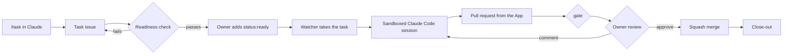

# task-agent

A request typed into Claude becomes a reviewed, merged pull request in any repo, with metrics.



## Key numbers

<!-- metrics:start -->
None yet. The loop's metrics appear here once tasks have run.
<!-- metrics:end -->

`make metrics PUBLISH=1` opens a pull request from the App that refreshes this table.

## Quickstart

```sh
make install
make install-skill
```

1. In Claude Code, type `/task` and say what should change. It files a task issue.
2. The readiness check comments on the issue. Edit the issue until every line reads `pass`.
3. The owner adds the `status:ready` label.
4. The owner runs `make watch` in their own terminal, on the machine that runs the watcher.
   It reads the App's key once, then takes ready tasks from every configured repo and opens
   one pull request per task.
5. The owner reviews each pull request, approves it and squash-merges it.

The App's key comes from the file `TASK_AGENT_KEY_FILE` names, kept outside every checkout
where sessions can't read it, or else from 1Password. `make doctor` checks the machine first,
and `make verify` proves the guardrails hold.

## How it works

- **Tasks are issues.** The form, the `/task` skill and the readiness check share one set of
  headings. State lives in labels: `status:triage`, `ready`, `claimed`, `review`, `blocked`.
- **Each task gets one session.** It runs in a fresh worktree of `main` with no network, no
  credentials and a short list of allowed commands.
- **The App publishes.** The dispatcher commits the work as the GitHub App, pushes it and
  opens the pull request. The session never holds a token.
- **To send a pull request back, comment on it.** `make send-back PR=5 NOTE="..."` does that
  too. The next pass runs a new session on the same branch with `main` merged in and the
  owner's comments as review text, then pushes a new commit. A pull request that conflicts
  with `main` is reworked the same way without a comment.
- **"Depends on" holds a task.** A ready task that names issues there, as `#N`,
  `owner/repo#N` or a URL, is not taken until each one is closed as completed. The watcher
  says which ones it is waiting on.
- **After a merge, close-out tidies up.** This workflow clears the status labels of the issues
  the pull request closed, labels a pull request the App didn't write `human-authored`, and
  files each `rule:` line under Lessons as a triage issue labelled `lesson`.
- **`make init REPO=owner/name` sets up another repo.** List the repo under
  `[tool.task-agent.repos]` first. One run sets labels and settings and opens a pull request
  with the task form and workflows; after that merges, a second run applies the ruleset.

### Guardrails

| Guardrail | What it stops | Where it is enforced |
|---|---|---|
| Only the owner starts work | A task marked ready by someone else, or edited after the owner's label | `approved` in `dispatch.py` |
| The sandboxed session | Network use, reading credentials, writing outside the worktree | `.claude/agent-settings.json`, `run_agent` in `dispatch.py` |
| Settings and prompts from `main` | A branch that loosens its own session's rules or limits | `show_main` in `dispatch.py` |
| The App's per-repo token and HTTPS push | A token that reaches other repos or outlives an hour; a push to a remote the checkout names | `app_token.py`, `push` in `dispatch.py` |
| Protected paths | An agent changing workflows, prompts, settings, the `Makefile` or dependencies | `protected` in `pr_format.py`, before the push and again in `gate` |
| `gate` running `main`'s checks first | A pull request that weakens the checks that judge it | `.github/workflows/gate.yml` |
| The ruleset on `main` | A merge without the `gate` check and the owner's approval after the last push | `.github/ruleset.json` |
| Rework preparing at `main` before the branch is checked out | A branch's own dependencies or settings running outside the sandbox | `prepare` and `checkout` in `dispatch.py` |
| Close-out reading only visible text | A closing line or a `rule:` hidden in a comment or a code block | `visible` in `pr_format.py` |

[docs/operations.md](docs/operations.md) covers the watcher, its requests, its log, blocked
tasks and running it elsewhere.

### How it was built

Three milestones were written by hand: the skeleton, the task form with its readiness check,
and the dispatcher with its guardrails. Everything after that is filed as tasks and built by
the loop on itself. The build's tasks are filed and marked ready from the owner's Claude Code
session, acting as the owner. The owner reviews and approves every pull request.

### Next

None of these is built yet:

- a forecast that reads the pipeline's totals
- automatic sample sync
- Slack
- project boards
- cloud dispatch
- an AI second reviewer

## Limitations

- Sessions run on the machine that runs the watcher, in checkouts that already exist there.
- The OS sandbox is proven only on macOS so far: `make verify` has not been run on Linux.
- The Python that runs a repo's tests must live outside the home folder, which sessions
  can't read.
- Rulesets need a public repo, or a paid plan for a private one.
- One GitHub App and one owner. There is no queue beyond the labels.

## Development

```sh
make check
```

`make help` lists every target. `make format` fixes style. `src/` is capped at 2,000 lines,
which `make loc` counts.

## License

MIT. See [LICENSE](LICENSE).
