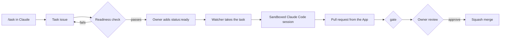

# task-agent

A request typed into Claude becomes a reviewed, merged pull request in any repo, with metrics.



## Key numbers

None yet. The loop's metrics appear here once tasks have run.

## Quickstart

```sh
make install
make install-skill
```

1. In Claude Code, type `/task` and say what should change. It files a task issue.
2. The readiness check comments on the issue. Edit the issue until every line reads `pass`.
3. The owner adds the `status:ready` label.
4. The owner runs `make watch` in their own terminal. It asks for Touch ID once, then takes
   ready tasks from every configured repo and opens one pull request per task.
5. The owner reviews each pull request, approves it and squash-merges it.

`make doctor` checks the machine first, and `make verify` proves the guardrails hold.

## How it works

- **Tasks are issues.** The form, the `/task` skill and the readiness check share one set of
  headings. State lives in labels: `status:triage`, `ready`, `claimed`, `review`, `blocked`.
- **Only the owner starts work.** A task is taken when the owner's `status:ready` label is the
  latest one and the title and body have not changed since.
- **Each task gets one session.** It runs in a fresh worktree of `main`, inside the OS sandbox,
  with no network, no credentials and a short list of allowed commands. Its settings, prompts
  and limits come from `origin/main`, never from the working tree.
- **The App publishes.** The dispatcher commits the work as the GitHub App, pushes over HTTPS
  with a token for that one repo, and opens the pull request. Tokens last under an hour.
- **`gate` judges the pull request from `main`'s code** before any of the change's code runs.
  App pull requests may not touch protected paths or close any issue but their own.
- **The ruleset on `main`** requires the `gate` check and the owner's approval after the last
  push. No agent pull request merges without both, and the App cannot change workflows.
- **After a merge, close-out tidies up.** It files each `rule:` line under Lessons as a triage
  issue, labels a pull request the App didn't write `human-authored`, and clears the status
  labels of the issues it closed.

[docs/operations.md](docs/operations.md) covers the watcher, its requests and its log.

### How it was built

Three milestones were written by hand: the skeleton, the task form with its readiness check,
and the dispatcher with its guardrails. Everything after that is filed as tasks and built by
the loop on itself. The build's tasks are filed and marked ready from the owner's Claude Code
session, acting as the owner. The owner reviews and approves every pull request.

## Limitations

- Sessions run on the owner's Mac. The sandbox settings are only tested on macOS.
- The Python that runs a repo's tests must live outside the home folder, which sessions
  can't read. Homebrew's Python does.
- Rulesets need a public repo, or a paid plan for a private one.
- One GitHub App and one owner. There is no queue beyond the labels.

## Development

```sh
make check
```

`make help` lists every target. `make format` fixes style. `src/` is capped at 1,800 lines,
which `make loc` counts.

## License

MIT. See [LICENSE](LICENSE).
